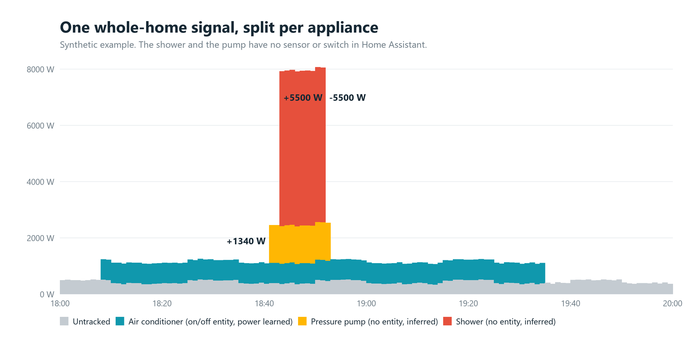

<p align="center">
  
</p>

# WattSplit

[](https://github.com/hacs/integration)
[](https://github.com/fdaneluzzi/wattsplit/releases)
[](https://github.com/fdaneluzzi/wattsplit/actions/workflows/tests.yml)
[](https://github.com/fdaneluzzi/wattsplit/actions/workflows/validate.yml)
[](LICENSE)
[](https://buymeacoffee.com/fdaneluzzi)

[](https://my.home-assistant.io/redirect/hacs_repository/?owner=fdaneluzzi&repository=wattsplit&category=integration)

**Per-appliance power and energy sensors in Home Assistant, estimated from your whole-home power signal, for appliances that have no power sensor, and even for those that have no entity at all.**

WattSplit watches the whole-home power signal (grid meter, per-phase sensors, solar inverters, battery) and infers *when* each appliance runs and *how much* it draws:

- **An appliance with an on/off entity but no power sensor** (a typical air conditioner, a washer): WattSplit learns its power from how the house signal changes when it switches, and uses the appliance's own energy counter, if it has one, as a starting point.
- **An appliance with no entity at all** (an electric shower, a water pressure pump, a pool pump): WattSplit sees the recurring steps in the house signal, asks you "what is this?" once, and from then on estimates its on/off state, power and energy.

Everything runs locally. Nothing leaves your Home Assistant.



> **Status: beta.** It runs on a real three-phase house with solar, but it is young. Tested on Home Assistant 2026.10 only. Estimates always carry a confidence, and WattSplit says "unknown" rather than guess when the evidence is thin. See [Limits](#limits).

## What you get

| You see | Where |
|---|---|
| Estimated power (W) and energy (kWh) per appliance, attached to the appliance's own device when it has one | Entities, Energy dashboard |
| A "running" binary sensor for appliances WattSplit infers | Entities |
| House power, untracked power and energy (what is still not explained) | Entities |
| Recurring loads WattSplit cannot explain, as a short question: *"A load of about 1340 W switched on 68 times over 7 days, about 6 minutes each. What is it?"* | **Settings > Repairs** |
| Estimated appliances listed next to the rest in the Energy dashboard (opt-in) | Energy dashboard |
| How much each estimate rests on (`evidence`), and an accuracy check against the appliances' own counters | Entity attributes, diagnostic entities |

There is no dashboard to build and no sidebar panel. Everything lives in places Home Assistant already has.

## Requirements

- Home Assistant **2026.10** or newer.
- At least one sensor that shows whole-home consumption or grid power. Several are better: per-phase sensors, several meters and several inverters all work.
- Sensors that update often help (every 10 to 15 s is great), but a sensor that reports once a minute, such as many solar inverters, is handled: WattSplit measures each sensor's real update rate and adapts.

## Install

### HACS (custom repository)

1. In HACS, open the menu and choose **Custom repositories**.
2. Add `https://github.com/fdaneluzzi/wattsplit` as an **Integration**.
3. Install **WattSplit** and restart Home Assistant.

### Manual

Copy `custom_components/wattsplit` into your Home Assistant `config/custom_components/` folder and restart.

## Set up

1. **Settings > Devices & services > Add integration > WattSplit.**
2. List what measures energy in your home, grouped by role: house total, grid meters, load sensors (per phase or circuit), solar inverters, batteries. Add as many of each as you have.
3. Add appliances: **Add appliance** on the integration page. For each one, link an on/off entity, a power sensor, both, or neither:

   | You link | WattSplit does |
   |---|---|
   | A power sensor | Subtracts it from the house signal, never estimates it |
   | An on/off entity (and optionally its energy counter) | Learns the appliance's power from the house signal |
   | Nothing, and you type its power (for example `5500`) | Detects it from steps of that size |
   | Nothing, no power | Waits for a discovered load to be assigned to it |

4. Optional: in the integration options, **import from the Energy dashboard** to create an appliance for each individual device already listed there, with its on/off entity and energy counter guessed from the same device.

Then let it run. The first estimates appear within hours (immediately for appliances with an energy counter, because the last 10 days of history are read from the recorder). The Repairs inbox fills over days.

## How it works

Every appliance leaves a fingerprint in the whole-home power signal: a 5500 W shower is a clean +5500 W step when it starts and -5500 W when it stops. WattSplit:

1. Detects steps on each measured channel, with a threshold that adapts to that channel's own noise and a window set by how often the sensor really reports.
2. Merges steps seen on several channels at once (an appliance on one phase, or fed partly by the inverter and partly by the grid).
3. Claims each step for the appliance whose on/off change (or declared power) explains it, and measures the rest into an inbox of recurring unexplained loads.
4. Learns each state-only appliance's power from the appliance's own energy counter first, then from the average of the house channels around its switching, then from consensus of steps, ranking the evidence and reporting the confidence.

The long version, with the design decisions and what does not work, is in [docs/ARCHITECTURE.md](docs/ARCHITECTURE.md).

## Limits

WattSplit is honest about what a single meter can and cannot tell apart:

- **Appliances that run together** add up in the meter. WattSplit separates them when their steps differ in size or timing, not when they switch at the very same second.
- **Variable-power appliances** (inverter air conditioners) are the hardest: the estimate is a long-run average while on, not the instantaneous power, and it says so with a lower confidence.
- **Small loads** below the step threshold (about 100 W by default, raised per channel by noise) stay in "untracked".
- **Energy counters** that appliances report are often modelled, not metered. They are a starting point and a cross-check, not the truth.
- **The Repairs suggestions** ("probably part of your A/C") are based on timing coincidence. Confirm only what you recognise. The one thing WattSplit never does without asking is hide a load for good, unless the evidence is overwhelming.

## Privacy and data

All processing is local. WattSplit stores a small SQLite log of detected steps and state changes in your `.storage` folder (kept 90 days) so that learning survives restarts and can be replayed. It makes no network calls.

## Translations

The integration is in **English**, with a **Brazilian Portuguese** translation. Home Assistant picks the language from your profile. Translations for other languages are welcome: copy `custom_components/wattsplit/translations/en.json`.

## Contributing

Issues and pull requests are welcome, especially: reports from setups unlike the author's (single-phase, no solar, other meters), and real-world cases where an estimate is wrong. See [CONTRIBUTING.md](CONTRIBUTING.md).

```bash
pip install pytest
python -m pytest
```

The engine (`custom_components/wattsplit/engine/`) has no Home Assistant dependency, and its tests run against a synthetic-house simulator in `tests/sim.py`.

## License

[MIT](LICENSE)
